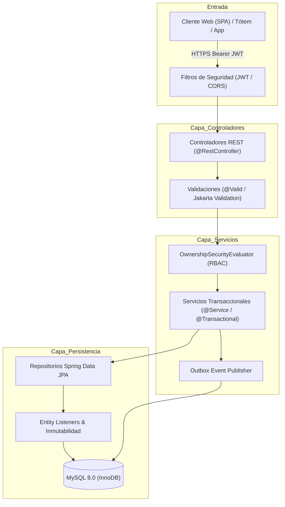

# Ecosistema de Salud Unificado (ESU) - Backend
> API REST para la interoperabilidad, gestión clínica inmutable, turnos médicos y receta digital en Cruz del Eje.

<p align="center">
  
  
  
  
  
  
</p>

---

## Tabla de Contenidos
1. [Visión General del Backend](#visión-general-del-backend)
2. [Arquitectura y Principios de Diseño](#arquitectura-y-principios-de-diseño)
3. [Stack Tecnológico](#stack-tecnológico)
4. [Estructura del Proyecto](#estructura-del-proyecto)
5. [Dominio Clínico y Entidades](#dominio-clínico-y-entidades)
6. [Marco Legal y Seguridad](#marco-legal-y-seguridad)
7. [Base de Datos y Migraciones (Flyway)](#base-de-datos-y-migraciones-flyway)
8. [Instalación y Ejecución Local](#instalación-y-ejecución-local)
9. [Despliegue con Docker Compose](#despliegue-con-docker-compose)
10. [Documentación de la API (Swagger UI)](#documentación-de-la-api-swagger-ui)
11. [Protocolo de Respaldo y Restauración](#protocolo-de-respaldo-y-restauración)
12. [Equipo de Desarrollo y Enlaces](#equipo-de-desarrollo)

---

## Visión General del Backend

El backend de **ESU** es una API REST robusta construida con **Java 17 / Spring Boot 3.3.4**, orientada a servicios de misión crítica en salud. Provee el motor de reglas de negocio, la persistencia transaccional relacional en **MySQL 8.4**, el control de acceso basado en roles y el cumplimiento estricto del marco legal clínico argentino.

### Capacidades Centrales:
* **Motor de Turnos Inteligente:** Cálculo de disponibilidad en tiempo real, bloqueo de agendas, prevención de solapamientos y cancelación segura.
* **Historia Clínica Única (HCU) Inmutable:** Registro clínico protegido bajo la **Ley Nacional 26.529**, con auditoría de accesos y sistema de adendas firmadas.
* **Diagnósticos Estándar CIE-10:** Catálogo internacional integrado para normalización de patologías.
* **Receta Digital Criptográfica:** Emisión de prescripciones firmadas con token unívoco, generación de código QR y validación para farmacias.
* **Transactional Outbox Pattern:** Mecanismo desacoplado y resiliente para la emisión confiable de eventos y notificaciones.

---

## Arquitectura y Principios de Diseño

El sistema implementa una arquitectura en capas limpia (**Layered Clean Architecture**) garantizando bajo acoplamiento y alta cohesión:



---

## Stack Tecnológico

| Componente | Tecnología | Versión | Rol |
| :--- | :--- | :--- | :--- |
| **Lenguaje** | Java (OpenJDK) | 17 (Target) / 21+ | Lenguaje base tipado y de alto rendimiento. |
| **Framework** | Spring Boot | 3.3.4 | Framework base para microservicios y APIs empresariales. |
| **Seguridad** | Spring Security & JJWT | 6.x / 0.12.6 | Autenticación stateless, Refresh Tokens y RBAC perimetral. |
| **Persistencia / ORM** | Spring Data JPA / Hibernate | 6.x | Mapeo objeto-relacional y ejecución transaccional ACID. |
| **Pool de Conexiones** | HikariCP | Integrado | Pool de conexiones ultraliviano y de alta velocidad. |
| **Base de Datos** | MySQL Server | 8.0 (InnoDB) | Motor de base de datos relacional para persistencia principal. |
| **Migraciones de BD** | Flyway | 10.x | Control de versiones evolutivo del esquema (`V1` a `V15`). |
| **Documentación API** | SpringDoc OpenAPI | 2.6.0 | Especificación OpenAPI 3 y consola Swagger UI interactiva. |
| **Productividad** | Project Lombok | 1.18.38 | Reducción de boilerplate de código Java. |
| **Contenedorización** | Docker / Compose | Multi-stage | Empaquetado y ejecución portable en producción. |

---

## Estructura del Proyecto

```text
Backend/
├── src/main/java/com/SaludUnificada/Esu/
│   ├── config/            # Configuración de Seguridad, CORS, OpenAPI, Auditoría JPA
│   ├── controlador/       # Controladores REST expuestos:
│   │   ├── AuthController.java            # Registro, login, refresh token, verificación
│   │   ├── TurnoController.java           # Creación, cancelación y disponibilidad de turnos
│   │   ├── HistoriaClinicaController.java # HCU, evoluciones y adendas
│   │   ├── RecetaDigitalController.java   # Emisión, consulta y dispensa en farmacia
│   │   ├── PacienteController.java        # Padrón y datos de pacientes
│   │   ├── ProfesionalController.java     # Gestión de médicos y disponibilidades
│   │   ├── CentroSaludController.java     # Centros, sedes y consultorios físicos
│   │   └── AdminController.java           # Auditoría, métricas y outbox
│   ├── dto/               # Data Transfer Objects (Request / Response)
│   ├── entidad/           # Entidades JPA del modelo relacional
│   ├── error/             # Manejo global de excepciones (`GlobalExceptionHandler`)
│   ├── evento/            # Eventos de dominio y Transactional Outbox
│   ├── mapper/            # Mapeadores entre Entidades y DTOs
│   ├── repositorio/       # Interfaces Spring Data JPA
│   ├── seguridad/         # JWT filter, UserDetails y `OwnershipSecurityEvaluator`
│   └── servicio/          # Lógica de negocio y transacciones
│
├── src/main/resources/
│   ├── db/migration/      # Migraciones Flyway V1__... a V15__...
│   ├── application.properties        # Configuración común
│   ├── application-dev.properties    # Perfil de desarrollo
│   └── application-prod.properties   # Perfil de producción
│
├── Dockerfile             # Construcción multi-stage de imagen productiva
├── mvnw / mvnw.cmd        # Maven Wrapper
└── pom.xml                # Gestión de dependencias y plugins de compilación
```

---

## Dominio Clínico y Entidades

El modelo relacional abarca todas las necesidades del ecosistema sanitario:

* **Historias Clínicas y Evolución:**
  * `HistoriaClinica`, `EvolucionMedica`, `EvolucionAdenda`, `PlantillaEvolucion`, `ConsultaBorrador`.
  * `LogAccesoHc`: Registro inalterable de accesos y consultas a la historia médica de cualquier paciente.
* **Prescripción Digital:**
  * `RecetaDigital`, `MedicamentoReceta`, `RecetaEstado` (Emitida, Dispensada, Vencida, Anulada).
* **Agendas y Turnos:**
  * `Turno`, `TurnoEstado`, `DisponibilidadProfesional`, `BloqueoAgenda`, `RecordatorioTurno`.
* **Usuarios y Prestadores:**
  * `Usuario`, `Paciente`, `Profesional`, `CentroSalud`, `ConsultorioFisico`, `Especialidad`.
  * `VinculoFamiliar`: Representación de dependientes o miembros a cargo.
  * `ConvenioObraSocial`: Coberturas y convenios activos.
* **Seguridad y Resiliencia:**
  * `RefreshToken`, `TokenRecuperacion`, `OutboxEvento`.

---

## Marco Legal y Seguridad

### Cumplimiento Ley 26.529 (Derechos del Paciente e Historia Clínica)
* **Principio de Inmutabilidad:** Las evoluciones médicas registradas cuentan con el listener `EvolucionInmutableListener` que rechaza operaciones de modificación (`UPDATE`) o borrado (`DELETE`) a nivel de entidad.
* **Mecanismo de Adendas:** Toda aclaración o ampliación posterior se realiza a través de `EvolucionAdenda`, registrando fecha, hora, matrícula del profesional y motivo médico.
* **Auditoría de Lectura:** Cada vez que un usuario visualiza una HCU, se persiste automáticamente un `LogAccesoHc` para fines de trazabilidad legal.

### Seguridad Criptográfica y RBAC
* **Autenticación Stateless:** Tokens **JWT (JSON Web Tokens)** con firma criptográfica HMAC-SHA 256 (`APP_JWT_SECRET`).
* **Refresh Tokens:** Almacenados en base de datos con expiración y revocación segura.
* **Evaluador de Propiedad (`OwnershipSecurityEvaluator`):** Reglas para asegurar que un paciente solo acceda a su propia información, un médico a sus consultas y pacientes asignados, y roles administrativos/farmacia a sus funciones específicas.
* **Validación al Inicio (`ProductionSecurityStartupValidator`):** Verificación automática al arrancar para asegurar que en producción no se utilicen claves por defecto ni secretos débiles.

---

## Base de Datos y Migraciones (Flyway)

El esquema de la base de datos se versiona estrictamente mediante **Flyway**, garantizando migraciones reproducibles en cualquier entorno:

```text
db/migration/
├── V1__esquema_inicial_usuarios_roles.sql
├── V2__centros_salud_y_especialidades.sql
├── V3__profesionales_y_disponibilidades.sql
├── V4__pacientes_y_vinculos_familiares.sql
├── V5__turnero_y_estados.sql
├── ...
└── V15__indices_rendimiento_y_auditoria.sql
```

Al iniciar el backend, Flyway inspecciona la tabla `flyway_schema_history` y aplica de forma automática las migraciones pendientes sin riesgo de inconsistencias.

---

## Instalación y Ejecución Local

### Prerrequisitos
* **Java Development Kit (JDK):** Versión 17 o 21 instalada.
* **MySQL Server:** Versión 8.0 en ejecución con base de datos `esu_db` creada.

### 1. Configuración de Variables
Copia el archivo `.env.example` o configura tus variables de entorno locales:
```bash
cp .env.example .env
```
Variables indispensables:
```env
SPRING_PROFILES_ACTIVE=dev
MYSQL_USER=esu_app
MYSQL_PASSWORD=tu_contraseña_local
APP_JWT_SECRET=clave_secreta_jwt_de_al_menos_256_bits_de_longitud_minima
CORS_ALLOWED_ORIGINS=http://localhost:5173
```

### 2. Ejecutar con Maven Wrapper

**En Windows:**
```powershell
.\mvnw.cmd clean spring-boot:run -Dspring-boot.run.profiles=dev
```

**En Linux / macOS:**
```bash
./mvnw clean spring-boot:run -Dspring-boot.run.profiles=dev
```

La API estará lista y escuchando en: `http://localhost:8080`.

---

## Despliegue con Docker Compose

Para levantar el entorno completo con base de datos MySQL y la API Spring Boot contenerizadas:

```bash
docker compose up -d --build
```

### Servicios iniciados:
* **MySQL 8.0:** Puerto `3306` (con verificación `mysqladmin ping`).
* **ESU Backend:** Puerto `8080` (con healthcheck en `/actuator/health`).

### Comprobación de salud:
```bash
curl -s http://localhost:8080/actuator/health
# Respuesta esperada: {"status":"UP"}
```

---

## Documentación de la API (Swagger UI)

Una vez iniciado el servidor en entorno local o de desarrollo:
* **Interfaz Swagger UI:** [http://localhost:8080/swagger-ui.html](http://localhost:8080/swagger-ui.html)
* **Especificación OpenAPI (JSON):** [http://localhost:8080/v3/api-docs](http://localhost:8080/v3/api-docs)

> En entornos productivos (`prod`), la consola Swagger se encuentra deshabilitada para usuarios sin rol `ADMIN`.

---

## Protocolo de Respaldo y Restauración

Para cumplir con la conservación de historias clínicas requerida por ley:

### 1. Respaldo en Caliente (Sin bloqueo)
```bash
docker exec esu_mysql mysqldump -u esu_app -p"${DB_PASSWORD}" \
  --single-transaction --quick --routines --triggers esu_db | gzip > backup_esu_$(date +%Y%m%d_%H%M%S).sql.gz
```

### 2. Restauración
```bash
gunzip < backup_esu_YYYYMMDD_HHMMSS.sql.gz | docker exec -i esu_mysql mysql -u esu_app -p"${DB_PASSWORD}" esu_db
```

---

## Equipo de Desarrollo
* **Martino Costigliolo**
* **Braian Aguilera**
* **Ricardo Cejas**
* **Ana Luz Nieto**
* **Nahuel Aguero**

---

### 🔗 Enlaces Relacionados
* **Repositorio Frontend:** [GitHub - Esu-Frontend](https://github.com/RicardoCejas/Esu-Frontend)
* **Gestión de Proyectos (PMI):** [Plan de Proyecto y Acta de Constitución](https://docs.google.com/document/d/1JAX4x0MIplwLKrF0S_HmMbUiuKS_gzoV/edit?usp=drive_link&ouid=110551275600190878595&rtpof=true&sd=true)
* **Documentación Técnica:** [Carpeta Oficial ESU en Google Drive](https://drive.google.com/drive/folders/1Fkj_hzJDNtrR1ZQJit4Ro4zfghxreBYk)
